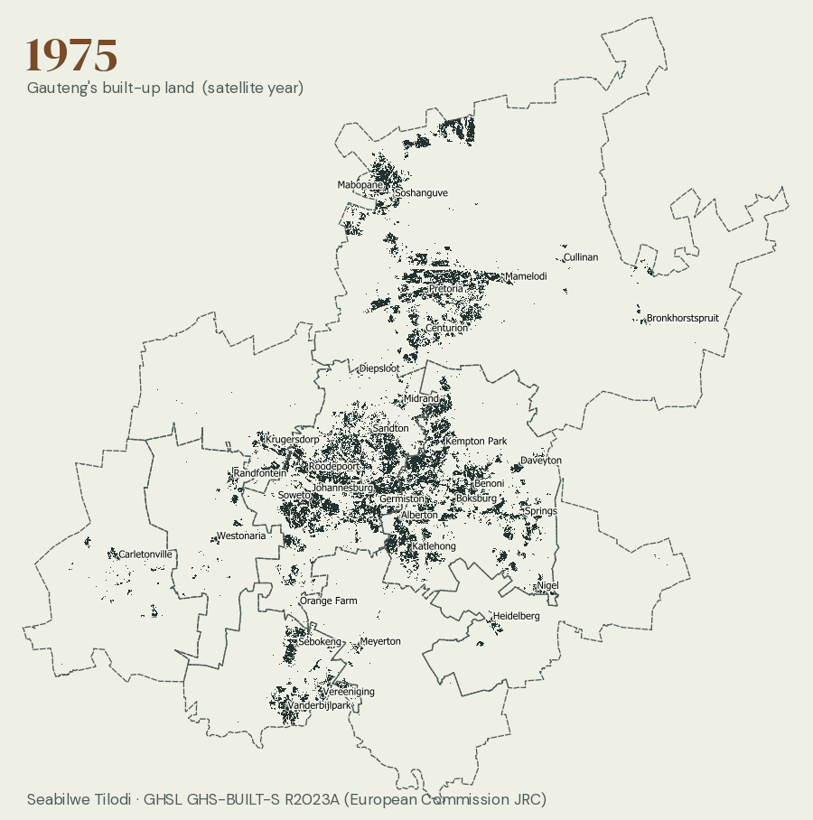

# urban-edge-za

**How Gauteng grew, 1975–2020.** This project traces 45 years of built-up land across Gauteng's nine municipalities, using the Global Human Settlement Layer. It asks three questions:
- Where did the city-region grow?
- Was the new land infill, edge growth or leapfrog development?
- Which municipalities grew denser, and which spread out?

**Explore it:** [seabilwe.github.io/map-urban-edge-za.html](https://seabilwe.github.io/map-urban-edge-za.html)



## Findings

| | 1975 | 2020 |
|---|---|---|
| Built-up land (hectares at least a fifth covered by buildings) | 1,214 km² | 2,443 km² |
| Area under buildings | 532 km² | 1,113 km² |
| Population (GHS-POP) | 5.3 million | 15.5 million |
| Built area per person | 100 m² | 72 m² |

- **Pace.** 1990–2000 was the fastest decade: about 43 km² of new built-up land a year. Other periods added 21–24 km² a year.
- **How the land was added.** About 60% of new land was edge growth, 20–25% infill and 12–21% leapfrog development.
- **Roads.** 62% of the land built up from 2000 to 2020 lies within 2 km of a main road. Only 41% of Gauteng is that close to one.
- **Rail.** Growth near railway stations was stronger before 2000 than after it.
- **Density.** The metros grew denser: Johannesburg's built area per person fell from 94 to 55 m². Midvaal and the West Rand spread out: Midvaal's rose from 154 to 224 m².
- **Checked against SANLC 2022.** South Africa's national land cover agrees on 95% of the land GHSL calls built-up.

## How it works

```
scripts/acquire_data.py      GHSL built-up (total and non-residential) and population tiles, 1975-2020; OpenStreetMap roads, stations, places
scripts/analysis.py          statistics on GHSL's own equal-area Mollweide grid (every cell is 1 ha): first-built year,
                             growth type (landscape expansion index), rings from the CBDs, corridors, municipalities, SANLC check
scripts/web_export.py        one packed RGBA image that drives the web timeline, plus GeoJSON and figures
scripts/urban_edge_layouts.py  four print sheets (UE-01 to UE-04) in QGIS
scripts/build_project.py     the QGIS project, with a Temporal Controller timeline and its animation export
scripts/make_gif.py          the animated GIF from the Temporal Controller frames
```

Run the scripts in the QGIS Python console, in that order. Everything except `make_gif.py` uses only what ships with QGIS (GDAL, NumPy and PyQGIS); `make_gif.py` needs Pillow.

**The web page.** It uses plain JavaScript with Leaflet. The browser recolours one image for each year, so the play button, slider, before-and-after swipe and click read-outs need no server.

## Limits

- **Estimated years.** Only 1975, 1990, 2000, 2014 and 2018 are satellite observations. The five-year steps in between are GHSL estimates.
- **The threshold.** A hectare counts as built-up land once a fifth of it is covered by buildings. That cut-off is a choice. The area under buildings needs no cut-off and shows the same trend.
- **Population.** GHS-POP spreads census counts using built-up land, so population density is partly modelled.
- **Boundaries.** Today's municipal boundaries are used for every year.

## Data

- GHS-BUILT-S and GHS-POP R2023A, European Commission, Joint Research Centre.
- SANLC 2022, DFFE.
- Municipal Demarcation Board boundaries, via geoBoundaries.
- © OpenStreetMap contributors.

The data isn't in this repository; the scripts download it.

## Licence

Code under the MIT licence. Data under its providers' terms.
